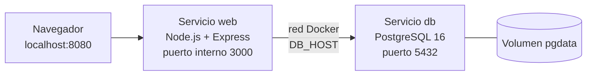
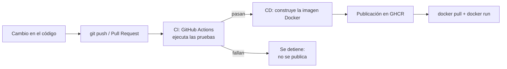

# Gestor de Películas – Equipo 5

Aplicación web contenerizada para gestionar películas, con base de datos PostgreSQL, pruebas automáticas, integración continua (CI) y entrega continua (CD) con GitHub Actions. La imagen Docker se publica automáticamente en GitHub Container Registry (GHCR).

## Integrantes

- Juan David Paz Trochez (GitHub: [GojoSatorouXD](https://github.com/GojoSatorouXD))
- Jose Luis Huila Obregón (GitHub: [Joseluis0221](https://github.com/Joseluis0221))

> Equipo conformado por 2 integrantes.

## Descripción

Aplicación web sencilla para gestionar películas (título, director, género, año y estado). Los datos se guardan en PostgreSQL y persisten aunque se detengan los contenedores.

## Funcionalidades

**Originales (primer parcial)**
- Crear, consultar, modificar y eliminar películas (CRUD).
- Persistencia en PostgreSQL con un volumen de Docker.

**Nuevas (segundo parcial)**
1. **Búsqueda y filtro por género:** se puede buscar por parte del título o del director (sin distinguir mayúsculas) y filtrar por género. Si no hay coincidencias se muestra "Sin resultados".
2. **Estado vista/pendiente:** cada película tiene un estado (`pendiente` por defecto). Un botón permite alternar entre `pendiente` y `vista`, y el listado se puede filtrar por estado. Además se valida que título, director y género no estén vacíos y que el año sea válido.

## Tecnologías y requisitos previos

- Node.js 20, Express y EJS
- PostgreSQL 16
- Jest y Supertest (pruebas)
- Docker y Docker Compose
- Git y GitHub (ramas y Pull Requests), GitHub Actions y GitHub Container Registry

**Requisitos previos:**
- Para ejecutar con Docker: [Git](https://git-scm.com) y [Docker Desktop](https://www.docker.com/products/docker-desktop/) (con Docker Compose).
- Para ejecutar las pruebas en local: además, Node.js 20 o superior.

## Arquitectura



## Flujo DevOps



## Estructura del proyecto

```
peliculas-devops/
├── .github/workflows/
│   ├── ci.yml              # Workflow de integración continua (pruebas)
│   └── cd.yml              # Workflow de entrega continua (imagen en GHCR)
├── src/
│   ├── app.js              # Aplicación Express y rutas (sin arrancar el servidor)
│   ├── server.js           # Arranque del servidor
│   ├── db.js               # Conexión a PostgreSQL y creación de la tabla
│   ├── peliculas.js        # Validación y construcción de filtros
│   └── views/              # Vistas EJS
├── tests/
│   ├── unit/               # Pruebas unitarias
│   └── integration/        # Pruebas de integración
├── Dockerfile
├── docker-compose.yml
├── package.json
└── README.md
```

## Configuración (variables de entorno)

| Variable | Función | Valor en docker-compose.yml |
|---|---|---|
| `DB_HOST` | Servidor de la base de datos (nombre del servicio en Docker) | `db` |
| `DB_PORT` | Puerto de PostgreSQL | `5432` |
| `DB_NAME` | Nombre de la base de datos | `peliculas` |
| `DB_USER` | Usuario de la base de datos | `peliculas_user` |
| `DB_PASSWORD` | Contraseña del usuario | `peliculas_pass` |
| `PORT` | Puerto interno de la aplicación (opcional) | `3000` |

El servicio `db` usa `POSTGRES_DB`, `POSTGRES_USER` y `POSTGRES_PASSWORD` con los mismos valores.

## Ejecutar desde el código fuente

1. Abrir Docker Desktop y esperar a que indique **Engine running**.
2. Clonar el repositorio y entrar a la carpeta:
   ```bash
   git clone https://github.com/GojoSatorouXD/peliculas-devops.git
   cd peliculas-devops
   ```
3. Construir e iniciar los servicios:
   ```bash
   docker compose up --build
   ```
4. Abrir **http://localhost:8080** cuando aparezca `App escuchando en puerto 3000`.
5. Para detener (los datos se conservan): `docker compose down`.

## Ejecutar las pruebas localmente

Las pruebas de integración necesitan PostgreSQL. Se usa una base **separada**, porque las pruebas borran datos. Su nombre debe contener la palabra `test`; si no, las pruebas se niegan a ejecutarse.

1. Instalar dependencias:
   ```bash
   npm install
   ```
2. Iniciar una base de datos de pruebas en el puerto 5433:
   ```bash
   docker run --name pg-test -e POSTGRES_USER=test -e POSTGRES_PASSWORD=test -e POSTGRES_DB=peliculas_test -p 5433:5432 -d postgres:16-alpine
   ```
3. Definir las variables de entorno.

   PowerShell:
   ```powershell
   $env:DB_HOST="localhost"; $env:DB_PORT="5433"; $env:DB_NAME="peliculas_test"; $env:DB_USER="test"; $env:DB_PASSWORD="test"
   ```
   Bash:
   ```bash
   export DB_HOST=localhost DB_PORT=5433 DB_NAME=peliculas_test DB_USER=test DB_PASSWORD=test
   ```
4. Ejecutar:
   ```bash
   npm run test:unit          # pruebas unitarias (no necesitan base de datos)
   npm run test:integration   # pruebas de integración
   npm test                   # todas
   ```
5. Al terminar: `docker rm -f pg-test`.

## Categorías de pruebas

| Categoría | Qué verifica | Archivo |
|---|---|---|
| **Unitarias** (18) | Funciones aisladas: la validación de una película (título, director, género y año vacíos o inválidos), la construcción de filtros de búsqueda por texto, género y estado, y la validación de estados. | `tests/unit/peliculas.test.js` |
| **Integración** (12) | La aplicación junto con PostgreSQL: crear, listar, modificar y eliminar; rechazo de datos inválidos; búsqueda y filtro por género; cambio de estado entre pendiente y vista; filtro por estado. | `tests/integration/peliculas.test.js` |

Las pruebas existentes también sirven como **pruebas de regresión**: al ejecutarlas después de cada cambio se detecta si una funcionalidad que antes funcionaba dejó de hacerlo.

## Workflows de GitHub Actions

| Workflow | Archivo | Eventos que lo activan | Qué hace |
|---|---|---|---|
| **CI - Pruebas** | `.github/workflows/ci.yml` | Apertura o actualización de un Pull Request hacia `main`; push a `main`; llamada desde otro workflow | Levanta una base PostgreSQL de pruebas, instala dependencias con `npm ci` y ejecuta las pruebas unitarias y de integración. Si una falla, termina en rojo. |
| **CD - Publicar imagen en GHCR** | `.github/workflows/cd.yml` | Push a `main`; ejecución manual (`workflow_dispatch`) | Job `pruebas`: reutiliza el CI. Job `publicar`: **solo si las pruebas pasan** (`needs: pruebas`), construye la imagen con el Dockerfile y la publica en GHCR con las etiquetas `latest` y `sha-<commit>`. |

**Qué está automatizado:** las pruebas, la construcción de la imagen y su publicación.
**Qué es manual:** escribir el código, la revisión y aprobación de los Pull Requests, el merge a `main` y, una sola vez, dejar el paquete como público.

## Imagen publicada en GHCR

- **Imagen:** `ghcr.io/gojosatorouxd/peliculas-devops`
- **Etiquetas disponibles:** `latest` (la versión más reciente) y `sha-<7 primeros caracteres del commit>`, por ejemplo `sha-3bb4caa`. La lista completa está en la sección *Packages* del repositorio.
- La imagen es pública: no hace falta iniciar sesión para descargarla.

### Descargar la imagen

```bash
docker pull ghcr.io/gojosatorouxd/peliculas-devops:latest
```

### Ejecutar la aplicación desde la imagen descargada

La aplicación necesita PostgreSQL, así que se crean una red y dos contenedores:

```bash
docker network create pelis-red

docker run -d --name pelis-db --network pelis-red \
  -e POSTGRES_DB=peliculas -e POSTGRES_USER=peliculas_user -e POSTGRES_PASSWORD=peliculas_pass \
  postgres:16-alpine

docker run -d --name pelis-web --network pelis-red --restart on-failure -p 8080:3000 \
  -e DB_HOST=pelis-db -e DB_PORT=5432 -e DB_NAME=peliculas \
  -e DB_USER=peliculas_user -e DB_PASSWORD=peliculas_pass \
  ghcr.io/gojosatorouxd/peliculas-devops:latest
```

En PowerShell, escribir cada comando en **una sola línea** (sin las barras `\`). Esperar unos 10 segundos y abrir **http://localhost:8080**.

- **Puerto:** la aplicación escucha en el 3000 dentro del contenedor y se publica en el 8080 del equipo.
- **Variables de entorno:** `DB_HOST`, `DB_PORT`, `DB_NAME`, `DB_USER` y `DB_PASSWORD`, como se describe en la sección de configuración.

Para limpiar:
```bash
docker rm -f pelis-web pelis-db
docker network rm pelis-red
```

## Git y trabajo colaborativo

Se trabajó con una rama por cada parte del proyecto. Cada cambio se integró a `main` mediante Pull Request revisado por el otro integrante.

| Rama | Contenido | Pull Request |
|---|---|---|
| `feature-aplicacion` | Aplicación Express y rutas CRUD | [#1](https://github.com/GojoSatorouXD/peliculas-devops/pull/1) |
| `feature-base-datos` | Conexión a PostgreSQL | [#2](https://github.com/GojoSatorouXD/peliculas-devops/pull/2) |
| `feature-docker` | Dockerfile | [#3](https://github.com/GojoSatorouXD/peliculas-devops/pull/3) |
| `feature-compose` | Docker Compose | [#4](https://github.com/GojoSatorouXD/peliculas-devops/pull/4) |
| `feature-readme` | README del primer parcial | [#5](https://github.com/GojoSatorouXD/peliculas-devops/pull/5) |
| `feature-busqueda` | Funcionalidad 1: búsqueda y filtro por género | [#6](https://github.com/GojoSatorouXD/peliculas-devops/pull/6) |
| `feature-estado` | Funcionalidad 2: estado vista/pendiente | [#7](https://github.com/GojoSatorouXD/peliculas-devops/pull/7) |
| `feature-pruebas-ci` | Pruebas automáticas y workflow de CI | [#8](https://github.com/GojoSatorouXD/peliculas-devops/pull/8) |
| `feature-cd-ghcr` | Workflow de CD hacia GHCR | [#9](https://github.com/GojoSatorouXD/peliculas-devops/pull/9) |
| `fix-prueba-fallida` | Demostración del CI en rojo y verde | [#10](https://github.com/GojoSatorouXD/peliculas-devops/pull/10) |
| `feature-readme-v2` | Este README | [#11](https://github.com/GojoSatorouXD/peliculas-devops/pull/11) |

## Persistencia

PostgreSQL usa el volumen `pgdata` (`/var/lib/postgresql/data`) definido en `docker-compose.yml`. Al ejecutar `docker compose down` y luego `docker compose up`, las películas registradas siguen disponibles. Usar `docker compose down -v` elimina también el volumen y borra los datos.